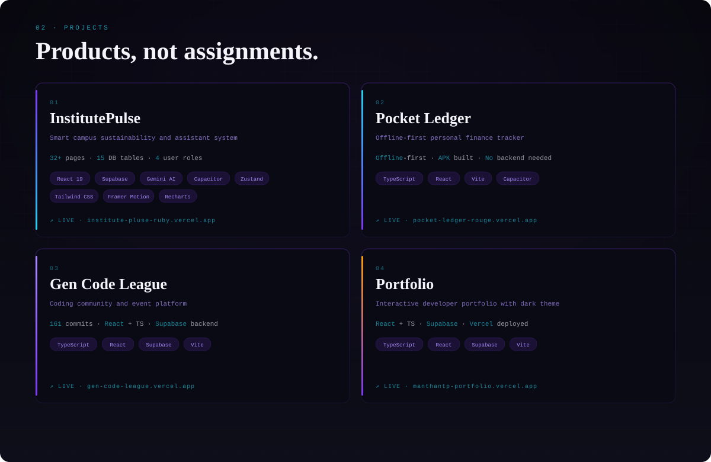
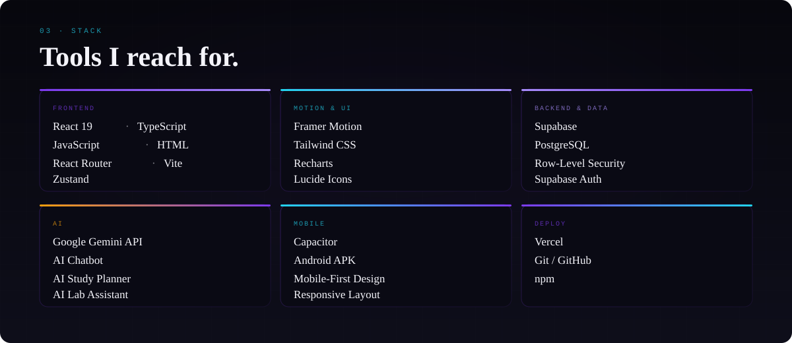

  

  &nbsp;
  &nbsp;
  &nbsp;
  

 

<!-- ── ABOUT ── -->

 

<!-- ── PROJECTS ── -->

  <strong>InstitutePulse</strong>&ensp;
  <a href="https://github.com/ManthanTP/institute-pluse">Repo</a> · <a href="https://institute-pluse-ruby.vercel.app">Live</a>
  &emsp;│&emsp;
  <strong>Pocket Ledger</strong>&ensp;
  <a href="https://github.com/ManthanTP/PocketLedger">Repo</a> · <a href="https://pocket-ledger-rouge.vercel.app">Live</a>
  &emsp;│&emsp;
  <strong>Gen Code League</strong>&ensp;
  <a href="https://github.com/ManthanTP/GenCodeLeague">Repo</a> · <a href="https://gen-code-league.vercel.app">Live</a>
  &emsp;│&emsp;
  <strong>Portfolio</strong>&ensp;
  <a href="https://github.com/ManthanTP/ManthanPortfolio">Repo</a> · <a href="https://manthantp-portfolio.vercel.app">Live</a>

 

<!-- ── STACK ── -->

 

<!-- ── STATS ── -->

  
  &nbsp;
  

  

 

<!-- ── FOOTER ── -->

